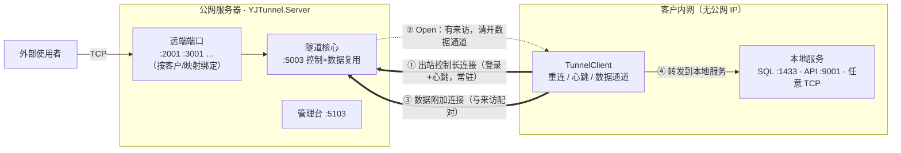

# YJTunnel

轻量级自研内网穿透（反向 TCP 隧道），纯 C# / .NET 8 实现，无第三方运行时依赖。

适用场景：客户内网服务器（无公网 IP）需要对外提供 TCP 服务（数据库、HTTP API 等），由一台有公网 IP 的服务器做中转。

> 诞生于一个 ERP 产品的远程运维通道：目标是用 2000 行以内的可维护代码，替换掉“经常掉线、必须重启才能恢复”的既有方案，并把**稳定性**作为第一设计目标。

## 特性

- **控制/数据分离**：一条出站长连接做控制（登录/心跳/指令），每条业务连接单独开一条数据通道——无多路复用、无队头阻塞，背压由 TCP 内核承担
- **三层断线判活**：应用层 Ping/Pong（20s/60s）+ TCP KeepAlive + 读超时（90s），双向；半开连接 60~90 秒内必被发现
- **单一重连循环**：指数退避（1→30s）+ 抖动，连接存活 >60s 才重置退避；Token 错误等终态不空转
- **半关闭正确传播**：依赖 FIN 语义的协议（如 SQL Server TDS）可正常工作
- **端口分配服务端权威**：客户端申请端口，服务端查黑白名单/唯一性/占用后分配并持久化；管理台可改端口并秒级推送生效
- **会话接管**：同一客户重连自动接管名下端口（epoch 归属隔离），掉线重连不会出现“端口永久失效”
- **内置管理台**：客户档案（登录自动记录公司名）、端口分配表（CSV 导出）、待审核接入、操作日志
- **首次启动自愈**：缺配置自动从模板生成；凭据占位符自动生成强随机值并打印到控制台
- **跨平台**：.NET 8，Windows 服务 / Linux systemd 双部署形态；管理台内嵌 Kestrel
- **桌面客户端**：Avalonia 12 + TKCode.Arc，NativeAOT 原生单文件（约 70MB），托盘常驻/可视化映射/开机自启

## 架构



**数据流**：外部使用者连公网端口 ①被服务端接受 → ②服务端经控制长连接通知客户端 → ③客户端主动拉一条数据通道挂接 → ④字节流在「来访连接 ⟷ 本地服务」之间双向搬运。

客户端永远只做**出站连接**，不需要公网 IP、不需要在客户侧开任何入站端口；客户端掉线时端口保持绑定，重连后自动恢复转发。

## 快速开始（中文）

### 1. 服务端（公网机器）

```bash
# 发布
cd src/YJTunnel.Server/deploy
bash publish-win.sh      # Windows → dist/tunnel-win
bash publish-linux.sh    # Linux   → dist/tunnel-linux

# Windows 安装为服务（需管理员）
deploy\install-win.bat "D:\Apps\YJTunnel"

# Linux
sudo mkdir -p /opt/yj-tunnel && sudo cp -r dist/tunnel-linux/* /opt/yj-tunnel/
# systemd 单元见 deploy/yj-tunnel.service
```

首次启动会自动完成：

1. 从 `configs/tunnelserver.json` 模板生成配置（缺配置自愈）；
2. 生成强随机 **登录 Token** 与 **管理台密码**（打印到控制台并写回配置文件）；
3. 绑定隧道口 5003，开始对外提供服务。

**唯一需要手工做的事**：在云厂商安全组放行 TCP 5003 与远端端口段（默认 2001-4999）。管理台端口 5103 切勿对公网放行。

### 2. 客户端（内网机器）

**方式 A：开箱即用的桌面客户端（推荐）**

`src/YJTunnel.Client` 是基于 Avalonia 12 + TKCode.Arc 的桌面产品客户端，NativeAOT 发布为原生可执行文件（无需 .NET 运行时）：

```bash
# Windows（需 VS2022「使用 C++ 的桌面开发」+ Windows 11 SDK）
scripts\publish-client-aot.bat        # 产物 → dist/client/win-x64
```

功能：可视化编辑端口映射、五态状态横幅、托盘常驻（四色状态图标/右键菜单/复制公网地址）、关闭即最小化、开机自启、单实例、诊断一键复制、踢下线封禁状态展示。详见 [客户端手册](docs/client.md)。

**方式 B：嵌入自己的程序**

项目引用 `src/YJTunnel/YJTunnel.csproj`（net8.0，无第三方依赖）：

```csharp
var config = new TunnelConfig
{
    Server = new ServerEndpoint { ServerAddr = "你的公网IP", ServerPort = 5003 },
    Token = "与服务端一致",
    CompanyName = "客户公司名（管理台自动显示）",   // 可选
    Forwards =
    {
        new ForwardConfig { LocalIp = "127.0.0.1", LocalPort = 1433, RemotePort = 0 }, // 0=服务端分配
        new ForwardConfig { LocalIp = "127.0.0.1", LocalPort = 9001, RemotePort = 0 },
    },
};
var client = new TunnelClient(config, clientId: Guid.NewGuid().ToString(), appVersion: "1.0.0");
client.Start();   // 内部单一重连循环，断线自动恢复
```

外部使用者连 `公网IP:分配的远端端口` 即等于连客户内网的对应本地服务。

### 3. 管理台

浏览器访问 `http://服务器IP:5103`（受来源 IP 白名单约束，默认仅本机回环）。功能：总览仪表盘、客户档案（登录自动记录公司名）、端口分配表（改端口秒级推送生效 + CSV 导出）、新客户端接入审批、操作日志。

## Quick Start (English)

1. **Server** (public machine): `bash src/YJTunnel.Server/deploy/publish-win.sh`, copy `dist/tunnel-win`, run `deploy\install-win.bat`. First start auto-generates the config, a random login **Token** and the **admin password** (printed to console). Allow TCP 5003 + 2001-4999 in your cloud security group.
2. **Client** (NAT-ed machine): either publish the desktop client (`scripts\publish-client-aot.bat`, self-contained native exe) or reference `src/YJTunnel/YJTunnel.csproj`, build a `TunnelConfig` (server addr/port, shared token, forwards), call `TunnelClient.Start()`. It reconnects forever with exponential backoff.
3. **Admin UI**: `http://server:5103` — customers, port table (change port pushes config to the client in seconds), pending approvals, audit log.

See `docs/` (Chinese) for protocol spec, deployment details and admin manual.

## 文档

- [协议规格](docs/protocol.md)
- [部署手册](docs/deploy.md)
- [管理台手册](docs/admin.md)
- [客户端手册](docs/client.md)

## 安全注意事项

- 隧道当前为**明文 TCP**（与多数同类工具默认形态一致）；配置预留 `Tls` 段（证书 + 强制校验，无“接受任意证书”选项），按需启用
- 请务必将管理台端口 5103 限制在运维网段（来源 IP 白名单 + 云安全组），并保管好自动生成的密码
- 远端端口对公网开放等同于把对应内网服务暴露出去——数据库端口建议仅用于远程维护，或配合防火墙白名单使用
- 所有管理操作与登录/断线事件均记录在 `logs/events.jsonl`（保留 90 天）

## 常见问题

**客户端一直显示“重连中”？** 检查 5003 端口连通性（云安全组/防火墙）、Token 是否与服务端一致。Token 错误属于终态失败，客户端会明确提示而不是无限重试。

**改了管理台端口分配没生效？** 在线客户端会立即收到变更通知并重连（通常 <10 秒）；若新端口被占用，管理台端口表会显示“未绑定 · 等待客户端重连”或“被他人持有”。

## License

[MIT](LICENSE)
